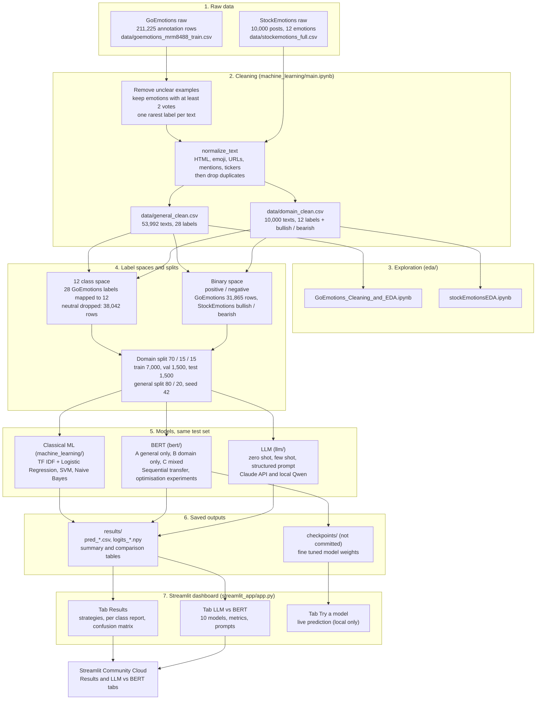

# Domain Adaptive Emotion and Sentiment Classification

This project measures how the choice of training data changes the performance of text classifiers on a specialised domain. A general domain dataset (GoEmotions, Reddit comments) and a financial domain dataset (StockEmotions, stock market social media posts) are used to train the same model architecture under controlled conditions, and every model is evaluated on the same held out financial test set. Classical machine learning, a fine tuned Transformer (RoBERTa) and large language models (Claude and a local Qwen model) are compared side by side, and all results are explored in a Streamlit dashboard.

**Headline findings**

1. Training on financial data matters most. On binary sentiment, the model trained on general data only reaches a macro F1 of 0.554, while the model trained on financial data reaches 0.804.
2. Transferring from the general domain does not beat training on financial data alone in these experiments. Sequential transfer (0.798) and mixed training (0.782) are close to, but not above, domain only training (0.804).
3. An LLM with no training at all gets close. Claude with a structured prompt reaches 0.799 macro F1 on binary sentiment, within 0.005 of the best BERT model, while a very small local LLM (Qwen2.5 0.5B) is much weaker (0.54 to 0.60).
4. The 12 class emotion task is hard for every approach. The best single BERT model reaches about 0.38 macro F1 and an ensemble of many models reaches about 0.39.

---

## 1. Pipeline overview

The graph below follows the data from the raw files to the Streamlit dashboard. Every box is backed by a notebook or a file in this repository.



---

## 2. Research question and experimental design

**Question:** how does the choice of training data influence model performance on a specialised domain?

The architecture is held fixed. Only the training data changes, which isolates the effect of the data.

| Model | Training data | Test data | What it measures |
| --- | --- | --- | --- |
| A, general only | GoEmotions | StockEmotions test | How well general knowledge transfers to a new domain |
| B, domain only | StockEmotions train | StockEmotions test | Performance with limited, but in domain, data |
| C, mixed | GoEmotions + StockEmotions train, trained once | StockEmotions test | Whether combining both helps |
| Sequential | GoEmotions first, then fine tuned on StockEmotions train | StockEmotions test | Primary transfer learning experiment |

Two tasks are evaluated.

1. **12 class emotion classification** (ambiguous, amusement, anger, anxiety, belief, confusion, depression, disgust, excitement, optimism, panic, surprise).
2. **Binary sentiment** (positive / negative). For GoEmotions the emotions are grouped by polarity. For StockEmotions the bullish and bearish labels are used.

---

## 3. Data

### 3.1 Datasets

| Dataset | Role | Raw size | After cleaning |
| --- | --- | --- | --- |
| GoEmotions | General domain (source) | 211,225 annotation rows, 28 emotions plus neutral | 53,992 unique texts, one label each |
| StockEmotions | Financial domain (target) | 10,000 posts, 12 emotions, bullish or bearish tag | 10,000 posts, no missing values or duplicates |

### 3.2 Cleaning steps (`machine_learning/main.ipynb`)

1. Remove the 3,411 GoEmotions rows flagged `example_very_unclear` (207,814 rows remain).
2. Group annotator rows by text, count votes per emotion, and keep emotions with at least 2 votes.
3. Resolve each text to a single label by choosing the rarest qualifying emotion, which limits the dominance of frequent classes (53,994 texts).
4. Apply `normalize_text`: unescape HTML, convert emoji to words, remove URLs and mentions, strip `$` from tickers, remove leftover symbols, collapse whitespace. StockEmotions uses its `processed` column as the starting text.
5. Drop duplicate texts created by the normalisation (53,992 texts for GoEmotions).
6. Save `data/general_clean.csv` and `data/domain_clean.csv`.

### 3.3 Label mapping, 28 GoEmotions labels to 12 StockEmotions labels

| StockEmotions label | GoEmotions labels mapped to it |
| --- | --- |
| ambiguous | realization |
| amusement | amusement |
| anger | anger, annoyance, disapproval |
| anxiety | nervousness |
| belief | admiration, approval, caring, pride, gratitude, love |
| confusion | confusion, curiosity |
| depression | sadness, grief, remorse, disappointment, embarrassment |
| disgust | disgust |
| excitement | excitement, joy |
| optimism | optimism, relief, desire |
| panic | fear |
| surprise | surprise |

`neutral` (15,950 texts) has no counterpart in StockEmotions and is dropped, leaving 38,042 general rows. This decision is supported by an ablation experiment but is still open to review.

For binary sentiment, 12 GoEmotions emotions are positive and 11 are negative. Confusion, curiosity, realization, surprise and neutral have no clear polarity and are dropped (31,865 rows: 20,132 positive, 11,733 negative).

### 3.4 Splits

| Pipeline | General data | Domain data | Seed |
| --- | --- | --- | --- |
| BERT and LLM, 12 class | 30,433 train, 7,609 validation | 7,000 train, 1,500 validation, **1,500 test** | 42 |
| BERT and LLM, binary | 25,492 train, 6,373 validation | 7,000 train, 1,500 validation, **1,500 test** | 42 |
| Classical ML | all 38,042 rows used for training | 8,000 train, **2,000 test** (5 fold cross validation inside training) | 42 |

All splits are stratified by label. The BERT and LLM experiments share exactly the same 1,500 test rows in the same order, so their predictions can be compared row by row. The classical ML baselines use a different 80 / 20 split, so their scores are indicative and are not directly comparable to the BERT and LLM tables.

---

## 4. Repository structure

```text
.
├── data/                 raw and cleaned datasets
├── eda/                  exploratory data analysis notebooks
├── machine_learning/     cleaning pipeline and TF IDF baselines
├── bert/                 Transformer fine tuning experiments
├── llm/                  zero shot, few shot and structured LLM prompting
├── streamlit_app/        Streamlit dashboard
├── results/              predictions, logits and summary tables written by the notebooks
├── docs/                 project description and report
├── ref-code/             reference code
├── requirements.txt      dependencies for the dashboard (Streamlit Community Cloud)
└── checkpoints/          fine tuned weights, created by bert/ notebooks, not committed
```

| Path | Contents |
| --- | --- |
| `data/` | `goemotions_mrm8488_train.csv`, `stockemotions_full.csv`, `general_clean.csv`, `domain_clean.csv` |
| `eda/` | `GoEmotions_Cleaning_and_EDA.ipynb` (raw data, cleaning, post cleaning exploration), `stockEmotionsEDA.ipynb` |
| `machine_learning/` | `main.ipynb`: cleaning, label mapping, TF IDF features, Logistic Regression, SVM, Naive Bayes for models A, B and C |
| `bert/` | `bert_final.ipynb` (reported results, clean pipeline), `bert_experiments.ipynb` (every experiment, ablation and extension) |
| `llm/` | `llm_experiments.ipynb`: LLM evaluation and the comparison with BERT |
| `streamlit_app/` | `app.py` |
| `results/` | `pred_*.csv` (true and predicted labels), `logits_*.npy`, `summary_bert.csv`, `summary_binary.csv`, `master_report_table.csv`, `llm_comparison_binary.csv`, raw LLM outputs `llm_raw_*.csv` |

Every notebook starts with a setup cell that moves to the repository root, so a notebook can be run from its own folder and the relative paths (`data/`, `results/`, `checkpoints/`) always resolve the same way.

---

## 5. Methods

### 5.1 Classical machine learning (`machine_learning/main.ipynb`)

* Features: TF IDF with up to 20,000 features, unigrams and bigrams, `min_df = 2`. The vectoriser is fitted only on that model's training text.
* Models: Logistic Regression, linear SVM and Multinomial Naive Bayes.
* Each of models A, B and C is tuned with a randomised search over a small grid, using 5 fold stratified cross validation and macro F1 as the score.
* Class weights are set to balanced for Logistic Regression and SVM.

### 5.2 BERT (`bert/bert_final.ipynb`, `bert/bert_experiments.ipynb`)

| Setting | Value |
| --- | --- |
| Base model | `cardiffnlp/twitter-roberta-base` |
| Max sequence length | 64 tokens |
| Learning rate | 3e-5, chosen on the validation split from {1e-5, 2e-5, 3e-5} (validation macro F1 0.3185, 0.3692, 0.3905) |
| Batch size | 32 |
| Epochs | domain only and sequential stage 2: 6, general only and mixed: 3, with early stopping (patience 2) |
| Loss | cross entropy with class weights (balanced weights raised to the power 0.5) and label smoothing 0.1 |
| Regularisation | dropout 0.1, weight decay 0.05 for small training sets (0.01 otherwise) |
| Schedule | cosine decay with 10 percent warm up |
| Model selection | best epoch by validation macro F1 |
| Seed | 42 |

Strategies: **B** (domain only), **A** (general only), **C** (mixed, 37,433 rows of which 18.7 percent are domain), and **Sequential** (a general only model is fine tuned again on the domain training set).

The experiments notebook also tests transfer techniques (dataset weighting, domain tags in the text), architecture variants (mean pooling, an RCNN head), parameter efficient tuning (LoRA), regularisation ablations, seed variation and ensembling.

### 5.3 LLM evaluation (`llm/llm_experiments.ipynb`)

The LLMs receive no training. They are given a prompt and must return one label.

| Prompt | Content |
| --- | --- |
| Zero shot | The task and the label names only |
| Few shot | Adds 2 labelled examples per label, taken from the training split only so that no test data leaks into the prompt |
| Structured | Adds a definition of each label (positive means bullish, negative means bearish), a rule to judge the stance toward the stock or market, and forces the answer to be one of the labels |

Two backends are used.

1. **Claude** (`claude-haiku-5-5`) through the Anthropic API. Structured prompts use a forced tool call whose label field is an enumeration, so the answer is always valid. Zero shot and few shot answers are parsed from text and counted as invalid when no label is found.
2. **Qwen2.5 0.5B Instruct** running locally. The label with the highest total log probability is chosen, so the output is always valid.

Raw outputs are cached in `results/llm_raw_*.csv` so interrupted runs resume. Predictions are saved as `results/pred_LLM_*_binary.csv` in the same format as the BERT predictions. The LLM experiments were run for binary sentiment only.

---

## 6. Results

All numbers are macro averaged and measured on the shared held out domain test set.

### 6.1 BERT, 12 class emotion (1,500 test rows)

| Strategy | Macro F1 | Accuracy |
| --- | --- | --- |
| B: domain only | 0.3645 | 0.3893 |
| C: mixed | 0.3564 | 0.4047 |
| Sequential transfer | 0.3528 | 0.3753 |
| A: general only | 0.1387 | 0.1680 |

### 6.2 BERT, binary sentiment (1,500 test rows)

| Strategy | Macro F1 | Accuracy |
| --- | --- | --- |
| B: domain only | 0.8040 | 0.8060 |
| Sequential transfer | 0.7983 | 0.8000 |
| C: mixed | 0.7820 | 0.7827 |
| A: general only | 0.5542 | 0.5813 |

### 6.3 Classical machine learning, 12 class (2,000 test rows, different split)

| Algorithm | A: general only | B: domain only | C: mixed |
| --- | --- | --- | --- |
| Logistic Regression | 0.1385 | 0.3671 | 0.2750 |
| SVM | 0.1443 | 0.3646 | 0.2982 |
| Naive Bayes | 0.0891 | 0.2437 | 0.2313 |

Values are macro F1. Domain only training is best for every algorithm, and mixed training is worse than domain only, which points to negative transfer.

### 6.4 BERT optimisation experiments, 12 class

| Experiment | Macro F1 |
| --- | --- |
| Ensemble of 16 models | 0.3895 |
| RCNN head | 0.3778 |
| Dataset weighting (on mixed data) | 0.3710 |
| Mean pooling | 0.3661 |
| LoRA | 0.3648 |
| Domain tags (on mixed data) | 0.3612 |
| Combined weighting, tags and LoRA | 0.3527 |
| Longer training, 12 epochs | 0.3491 |

Most differences from the baseline (0.3645) are within seed to seed variation (0.355 to 0.365), so they should not be read as significant.

### 6.5 LLM versus BERT, binary sentiment (1,500 test rows)

| Model | Type | Accuracy | Precision | Recall | Macro F1 |
| --- | --- | --- | --- | --- | --- |
| BERT B: domain only | trained | 0.806 | 0.804 | 0.804 | 0.804 |
| Claude structured | no training | 0.801 | 0.799 | 0.799 | 0.799 |
| BERT Sequential | trained | 0.800 | 0.798 | 0.799 | 0.798 |
| BERT C: mixed | trained | 0.783 | 0.782 | 0.785 | 0.782 |
| Claude zero shot | no training | 0.756 | 0.757 | 0.758 | 0.756 |
| Claude few shot | no training | 0.751 | 0.755 | 0.753 | 0.752 |
| Qwen 0.5B zero shot | no training | 0.597 | 0.604 | 0.603 | 0.597 |
| Qwen 0.5B few shot | no training | 0.592 | 0.632 | 0.612 | 0.582 |
| BERT A: general only | trained | 0.581 | 0.574 | 0.563 | 0.554 |
| Qwen 0.5B structured | no training | 0.548 | 0.571 | 0.564 | 0.542 |

### 6.6 What the results show

1. **Domain data dominates.** Models that see financial text during training (B, C, Sequential) beat the general only model by about 0.25 macro F1 on binary sentiment, and by about 0.23 on the 12 class task.
2. **Transfer did not help here.** Sequential and mixed training stay at or just below domain only training, so the primary transfer experiment does not show a gain.
3. **A strong LLM is competitive without labels.** Claude with a structured prompt is nearly as good as the best trained model, and the definitions in the structured prompt help (0.799 against 0.756 for zero shot). A very small LLM cannot use that extra information and does worse with it.
4. **Few shot did not add value** over zero shot for Claude with two examples per label.
5. **Output reliability.** Claude zero shot returned 3 and few shot 8 answers that were not a single label. Structured prompting had none.
6. **Label meaning differs between domains.** For example, many anxiety and disgust posts in StockEmotions are bullish, so emotion based polarity from GoEmotions does not equal market direction. This helps explain why the general only model is weak on the binary task.

---

## 7. Streamlit dashboard

The dashboard makes the whole process explorable. It reads only files that are saved in the repository, so it does not need to retrain or call any model for the first two tabs.

| Tab | What it shows | Data it reads |
| --- | --- | --- |
| Results | Choose 12 class or binary. A table and chart of macro F1 and accuracy for A, B, C and Sequential, then a per class precision, recall and F1 report and a confusion matrix for the selected strategy | `results/pred_*.csv` |
| LLM vs BERT | Ten models side by side (four BERT strategies, three Claude prompts, three Qwen prompts) with accuracy, precision, recall, macro F1 and number of invalid outputs, a macro F1 chart, an explanation of the three prompt types, and a per class report and confusion matrix for any selected model | `results/pred_B1_bin.csv`, `pred_Seq_bin.csv`, `pred_C_bin.csv`, `pred_A_bin.csv`, `pred_LLM_*_binary.csv` |
| Try a model | Type a sentence and see the probability of every label from a fine tuned checkpoint | `checkpoints/<name>/best` (local only) |

### Run locally

```bash
pip install -r requirements.txt
python -m streamlit run streamlit_app/app.py
```

For the live prediction tab also install `torch` and `transformers`, and place checkpoints in `checkpoints/<name>/best` (they are created by `bert/bert_final.ipynb` with `trainer.save_model("checkpoints/<name>/best")`).

### Deploy on Streamlit Community Cloud

1. Push the repository to GitHub (the account that owns the repository must have admin rights, which Streamlit requires to deploy).
2. On share.streamlit.io create a new app from this repository and branch.
3. Set the **main file path** to `streamlit_app/app.py`.
4. The app installs from `requirements.txt`. `torch` is not installed on the cloud, and the app detects this, so the Results and LLM vs BERT tabs work and the Try a model tab shows an explanatory message.

---

## 8. How to reproduce

### 8.1 Environment

Python 3.13 with the packages used in the experiments: pandas, numpy, scikit-learn, matplotlib, torch, transformers, datasets, peft, emoji, streamlit, and optionally anthropic and python-dotenv for the Claude experiments. The notebooks were developed on macOS with Apple Silicon (MPS).

On macOS, import `torch` before `scikit-learn` or `matplotlib`. Importing them in the other order can crash Python because of a clash between OpenMP libraries. The notebooks and the app already follow this order.

### 8.2 Order of execution

1. `eda/` notebooks (optional, descriptive analysis).
2. `machine_learning/main.ipynb`. It writes `data/general_clean.csv` and `data/domain_clean.csv`.
3. `bert/bert_final.ipynb`. Training writes `checkpoints/` and the files in `results/`. A markdown note in the learning rate section explains how to skip the sweep: the cell after it sets `BEST_LR = 3e-5` directly.
4. `llm/llm_experiments.ipynb`. Settings at the top: `TASK`, `N_SAMPLE` (use a small number for a dry run, `None` for the full test set), `RUN_LOCAL`, `RUN_CLAUDE`.
5. The dashboard.

### 8.3 Claude API key

Create a file named `.env` in the repository root with one line, `ANTHROPIC_API_KEY=your key`. It is listed in `.gitignore` and must never be committed. Install the SDK with `pip install anthropic python-dotenv`, set `RUN_CLAUDE = True`, and run the notebook. Start with `N_SAMPLE = 20` to check cost and setup. Cached results mean a later full run only pays for the rows that are missing. If you change a prompt, delete `results/llm_raw_claude_*` before rerunning.

### 8.4 Reproducibility notes

* Seed 42 is used for splits, sampling of few shot examples, and training.
* All BERT and LLM results use the same 1,500 test rows in the same order.
* Large model weights and API keys are not stored in the repository.

---

## 9. Limitations and open items

1. **Single run.** Every configuration was run once with one seed (and one Claude model), so small differences, such as 0.799 against 0.804, are not statistically established.
2. **Different splits.** The classical ML baselines use an 80 / 20 domain split with 2,000 test rows, while BERT and the LLMs use a 70 / 15 / 15 split with 1,500 test rows. Compare them as indicative only.
3. **Label semantics.** The binary labels differ between domains (emotion polarity against bullish or bearish), which limits what a general only model can learn.
4. **Learning rate.** It was chosen on the domain only model and then reused for all strategies, which may slightly favour domain only training.
5. **Neutral class.** Dropping `neutral` from GoEmotions is supported by an ablation but remains a modelling decision.
6. **Ensemble numbers.** Different result files report different ensemble scores (0.3895, 0.3909, 0.3968); the value in section 6.4 comes from `results/master_report_table.csv`.
7. **LLM coverage.** The LLM experiments cover binary sentiment only; the 12 class task has not been run with an LLM.
8. **Dashboard on the cloud.** Live prediction is unavailable there because it needs `torch` and the checkpoint files. The only checkpoints saved are general only models (strategy A).
9. **Qualitative analysis.** A written error analysis (domain vocabulary, bias patterns, failure cases) built on the saved predictions is still to be completed for the report.
